# Content-Based Similar Image Retrieval

A C++ and OpenCV program that searches a folder of images by what they look like. Give it a national flag or a vehicle logo and it returns the closest pictures in the collection, ranked by a numeric distance. No keywords, no labels, and no manual tagging.

The collection is two fixed sets: **76 national flags** and **61 vehicle logos**. Flags are compared by colour. Logos are compared by outline, and again by colour once the outline has narrowed the list. The full write-up, with the literature review and every evaluation table, is [`report.docx`](report.docx) (Goh Kien Chun, May 2017, submitted to Prof. Dr. Zen Chen).

A smaller distance means a closer match. When the query picture is also stored in the dataset, rank 1 is that same picture and the distance is 0.

## What you can show in one minute

| Mode | Menu | Dataset | What “similar” means | Result |
| --- | --- | --- | --- | --- |
| Colour | `1` | 76 flags | Same dominant colours, then the same left/right layout | Blue-ensign flags cluster; a waving flag still finds its flat copy |
| Shape | `2` | 61 logos | Same outer silhouette, then a Hu-moment check | Drawings of one character stay together; ovals stay with ovals |
| Combined | `3` | 61 logos | Silhouette first, then foreground colour | Shield logos stay in the list, and yellow Ferrari shields separate from red-and-black Porsche shields |

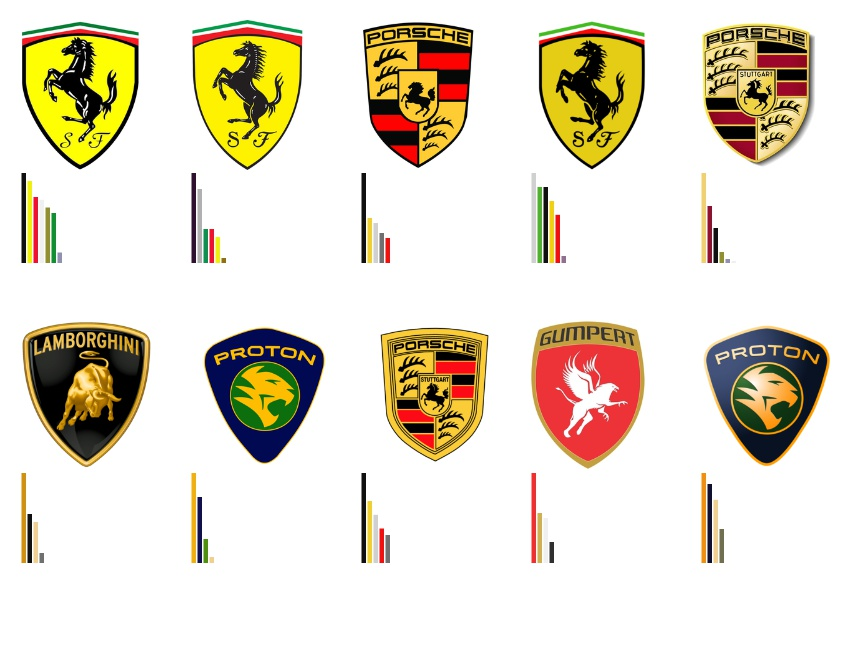

The board above is the combined descriptor on a Ferrari query. The first row is shield-shaped and mostly yellow or gold. The second row is still shield-shaped, with different colour mixes (Lamborghini, Proton, Gumpert). Shape decided who entered the top 10. Colour decided the order.

## How to run it

The project is a Visual Studio 2013 Win32 console program (toolset v120) linked to OpenCV 3.0.0.

1. Install OpenCV 3.0.0 so the headers are in `C:\opencv\build\include` and the Win32 Visual C++ 2013 libraries are in `C:\opencv\build\x86\vc12\lib`. Debug links `opencv_world300d.lib`. Release links `opencv_world300.lib`. Those paths are set in `SimilarImageRetrieval/OpenCV30_Debug.props` and `SimilarImageRetrieval/OpenCV30_Release.props`.
2. Open `SimilarImageRetrieval.sln` and build the Win32 configuration.
3. Start the program with its working directory set to `SimilarImageRetrieval/`. The code loads `Flag_Datasets/*.jpg` and `Logo_Datasets/*.jpg` with relative paths, and the sample queries (`malaysia.jpg`, `ferrari.jpg`, `germany.jpg`, and the other loose JPEG files) sit in that same folder.
4. At `Please input query image:` type a short file name, for example `malaysia.jpg` or `ferrari.jpg`. The input buffer holds 19 characters.
5. Pick a menu option. Use option `1` for a flag and option `2` or `3` for a logo.

```
(1)  Colour Descriptor (Flag)
(2)  Shape Descriptor (Logo)
(3)  Combined Descriptor (Logo)
(4)  Try Another Query Image
(5)  Exit
```

Each run opens an OpenCV window and writes a JPEG next to the project. The names the program saves are `Colour Region Moment.jpg`, `Average Pixel Percentage.jpg`, `Moment.jpg`, `Hu Moment.jpg`, and `Similarity Score of Combined Discriptor.jpg`. Press a key in the image window to return to the menu. Options `4` and `5`, and the `system("cls")` / `system("pause")` calls, are Windows console commands.

## The three algorithms

All three modes rank images by Euclidean distance and keep the smallest distances. The implementation is `SimilarImageRetrieval/Source.cpp` (the menu and the three pipelines) and `SimilarImageRetrieval/ImageProcessing.cpp` (quantization, moments, distances, and the result boards).

```
query image
    │
    ├─ option 1, flags ── colour histogram of the whole flag
    │                      └─ re-rank by colour-region shape
    │                      └─ re-rank by left half + right half
    │
    ├─ option 2, logos ── outer silhouette (central normalized moments)
    │                      └─ Hu moments on the top 10
    │
    └─ option 3, logos ── silhouette on all 61 logos
                           └─ foreground colour on the top 10
                           └─ left/right colour average, then show 10
```

### 1. Colour descriptor (flags)

Flags have no separate background, so every pixel counts. `wholeImage` does five things.

**Quantize RGB into 512 bins.** Each channel is 0–255. Dividing by 32 folds a channel into 8 levels (0–7). A pixel becomes one of 512 bins:

```
b = B / 32,   g = G / 32,   r = R / 32
bin = b * 64 + g * 8 + r
```

The program paints the bin back as a colour by using the middle of that bin, `level * 32 + 16`, so the quantized flag is still recognizable. A waving Malaysia flag is the running example in the report: cloth shading, stripes, and the canton produce a long histogram of near-reds, near-greys, and near-blues.

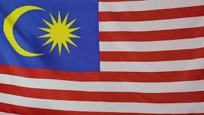

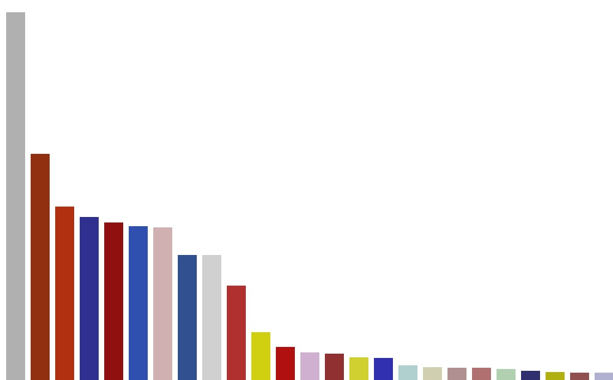

**Merge bins that a person would call the same colour.** Bins are sorted by pixel count. A lower-ranked bin is repainted with a higher-ranked bin when both of these are true (`threshold = 32` in `wholeImage`):

```
|B − Bi| ≤ 96,  |G − Gi| ≤ 96,  |R − Ri| ≤ 96
|B − Bi| + |G − Gi| + |R − Ri| ≤ 192
```

Those cutoffs were chosen by trying values on the flag set (report, section 3.1.2). On the Malaysia flag the report records the histogram falling from 167 bins to four colours: red, grey, blue, and yellow. The merged picture is what later distance functions actually see.

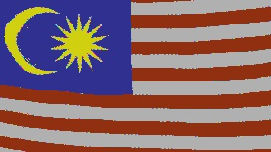

**Drop the noise tail.** After the merge, colours are sorted again. Colour *i* is kept only while its pixel count is greater than 10% of colour *i − 1*. A tiny yellow star survives because it is still large next to the colour above it. A handful of shadow pixels does not.

**First-stage score: matching colour proportions.** `euclideanDistance_pixelPercentage` walks the dominant colours of the query and of a dataset flag. Two colours count as the same colour when their 8-level bins are close:

```
|b1 − b2| ≤ 2,  |g1 − g2| ≤ 2,  |r1 − r2| ≤ 2
|b1 − b2| + |g1 − g2| + |r1 − r2| ≤ 3
```

For every matched pair the function adds the squared gap between the two area fractions. A colour that exists on only one side is compared with 0. The distance is the square root of that sum. Dividing by the image area (`rows * cols`) makes a large flag and a small flag comparable.

```
d = sqrt( Σ (count_query / area_query − count_dataset / area_dataset)² )
```

This score cares about *how much* red, white, and blue a flag contains. It does not yet care whether the blue is on the left or on the right. That is why Germany and Belgium, which share black, red, and gold in different directions, need a second stage.

The saved first-stage board below is a blue-ensign query (New Zealand and the flags that share its blue field, Union Jack, and red stars). Rank 1 is the query. The next hits are other blue ensigns. Bangladesh, South Africa, and a green-triangle flag only appear once the blue-field matches run out. In the current `Source.cpp` the `imwrite` for this first-stage board is commented out; a fresh run of option `1` saves the two second-stage boards only. The file in the tree is the board from when that save was still enabled. The report’s Table 3-3, for this kind of first-stage run, spreads from 0.00 at rank 1 to 0.179 at rank 10.

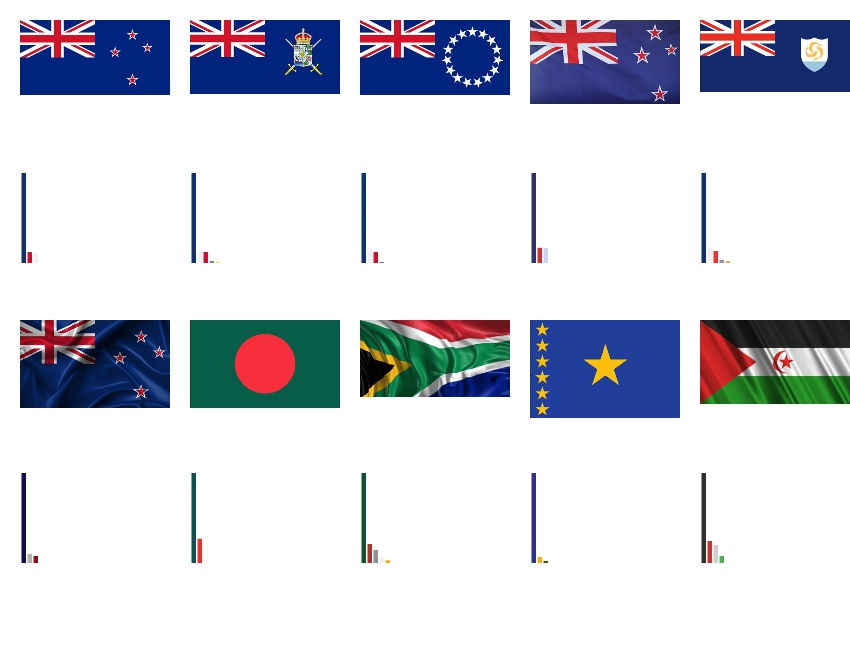

| Rank | Distance |
| --- | --- |
| 1 | 0 |
| 2 | 0.0410021 |
| 3 | 0.0492752 |
| 4 | 0.0764392 |
| 5 | 0.081641 |
| 6 | 0.13596 |
| 7 | 0.14823 |
| 8 | 0.169097 |
| 9 | 0.174316 |
| 10 | 0.178923 |

Distances are the published first-stage pixel-percentage scores from the report, Table 3-3.

**Second stage, layout.** Two different re-rankings run on the shortlist.

*Left/right average.* `roi` cuts the flag at the vertical midline. The same pixel-percentage distance is computed on the left halves and on the right halves, then averaged:

```
d = (d_left + d_right) / 2
```

A vertical tricolour makes the point. The saved split of that flag is a black-and-yellow left half and a yellow-and-red right half. A horizontal tricolour in the same three colours has nearly the same left half and right half, so the average pushes it down the list.

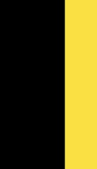
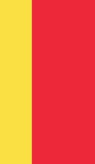

*Colour-region moments.* For each dominant colour the program builds a binary mask (white where that colour is) and measures the shape of that mask with seven central normalized moments: `nu02`, `nu03`, `nu11`, `nu12`, `nu20`, `nu21`, `nu30`. Matched colours contribute the Euclidean distance between those seven numbers. An unmatched colour is compared with zeros, so a flag that has an extra colour region is penalized. The mask below is one colour region of a New Zealand-type flag: the Jack and the stars, isolated from the field.

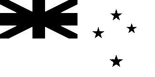

On a waving Sahrawi-type query (green triangle, red crescent and star), the two second-stage boards look like this. Both still put the query first. The left/right average then surfaces other red-white-black-green flags (Netherlands, UAE, France, South Africa) because each half has a similar colour mix. The colour-region moments pull more copies of the same crescent-and-triangle flag into the top row, because the green triangle and the star occupy the same part of the picture.

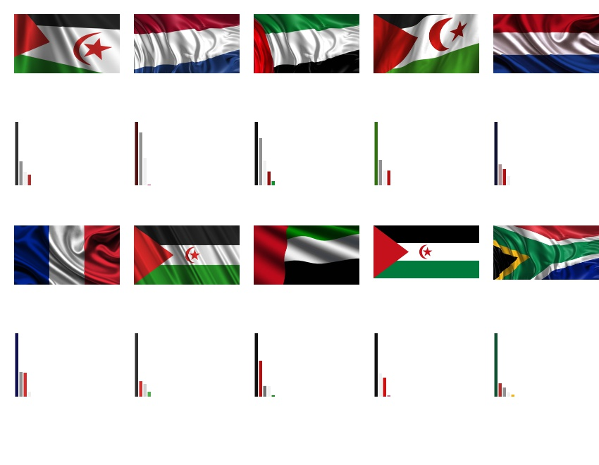

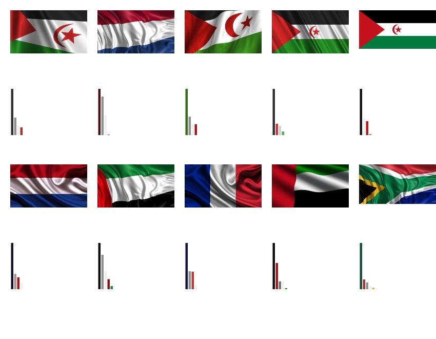

Across the queries in the report, matching colour by proportion was the more stable of the two colour scores. Region moments help when two flags share a palette and differ in where each colour sits. Chapter 5 records both, query by query.

### 2. Shape descriptor (logos)

Logos sit on a plain background, almost always white. Colour would treat that background as the dominant “colour” of every logo, so this mode ignores colour and uses the outer contour. `findContour` follows six steps.

1. Convert BGR to grey.
2. Threshold at 220 with `THRESH_BINARY_INV`. Pixels at 220 or above (the white page) become black. Darker pixels (the logo) become white.
3. Flood-fill from the top-left corner, which is background, with white.
4. Invert that flood-filled image.
5. Bitwise-OR it with the binary image. Holes inside the logo fill in. The result is a solid white silhouette.
6. Compute the same seven central normalized moments on that silhouette.

The Ferrari shield, which is the worked example in the report:

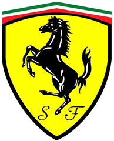
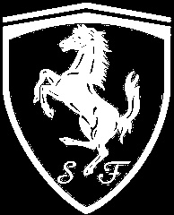
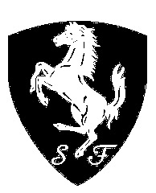
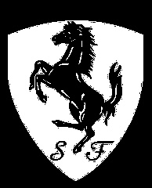
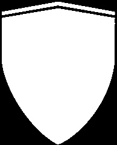

`euclideanDistance_nuMoment` is the Euclidean distance between the two 7-vectors. Scale cancels out because the moments are normalized, so a small round badge and a large round badge land near each other. Rotation does **not** cancel out. A horizontal ellipse and a vertical ellipse produce different vectors, which is what this dataset needs: a Bugatti-style horizontal ellipse and a Maserati-style vertical ellipse should stay apart. The report’s Table 3-1 gives one Ferrari silhouette as:

| Moment | Value |
| --- | --- |
| nu02 | 0.097626 |
| nu03 | 0.00610753 |
| nu11 | 0.000949622 |
| nu12 | 0.00013218 |
| nu20 | 0.0697717 |
| nu21 | −0.00526489 |
| nu30 | −0.00018855 |

The first-stage board saved with the project is a Mickey Mouse query. The five closest silhouettes are Mickey drawings. The next family is the vertical oval (four Maserati badges), and a Porsche shield only appears at the end of the ten.

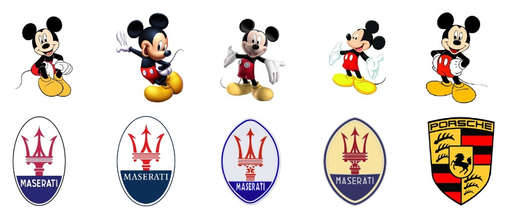

The second stage takes those ten silhouettes and re-scores them with OpenCV `matchShapes` in mode `CV_CONTOURS_MATCH_I1` (Hu moments). Hu moments are built to ignore rotation. On this set that is a drawback: orientation is part of the trademark. In the saved board the Porsche shield moves up into the oval row.

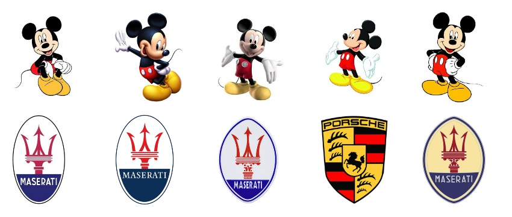

The report’s conclusion in Chapter 5 follows this comparison. Central normalized moments stayed reliable across circles, horizontal ellipses, vertical ellipses, shields, winged circles, and three-diamond marks. Hu moments were precise on a few shapes and mixed the others up. The program still shows both, so the difference can be demonstrated live.

### 3. Combined descriptor (logos)

Option `3` runs shape, then colour, on the logo set.

1. Score all 61 logos by central normalized moments and keep the closest 10.
2. On that shortlist, read colour only where the foreground mask is white (`eliminateBackground`). The white page never becomes a dominant colour.
3. Split each remaining logo into left and right halves, average the two pixel-percentage distances, and show that order. The console also prints the shape distance next to the colour distance. The window shows each logo above the histogram of its foreground colours.

The Ferrari board at the top of this document is that result. Shields survive step 1. Step 3 then groups the yellow shields ahead of the black, blue, and red shields. The report’s Figure 3-20 states the assumption this depends on: the background is one plain colour. A photograph with a busy background will leak into the mask and into the histogram.

## What the evaluation found

Chapter 4 of the report checks the pipelines on six kinds of variation. The colour path still returns the right flag for a brighter copy, a waving copy, a shadowed copy, and a differently scaled copy. The shape path still returns the right logo for a rotated copy and for a flat logo paired with a 3D rendering of the same badge.

Chapter 5 compares the scoring choices on a series of queries.

- Matching colours by their area fraction is more stable than treating “the first colour, the second colour, …” as an ordered signature. Two photos of one flag rarely rank their colours in exactly the same order once shading is present. They do keep similar proportions.
- Central normalized moments are the shape score to trust on this logo set. Hu moments collapse orientations that the collection treats as different trademarks.
- Two stages are the reason the ranking is tighter than a single feature. The first stage is cheap and wide (every flag, or every logo). The second stage is slower and only runs on the top 10, where layout or a second feature can break ties.

Chapter 6 records the limits in the same terms:

- Flag accuracy still has room to improve. Flags that share a palette and a coarse layout (red, white, blue, with a cross or a stripe) remain near each other.
- The system expects the collection it was tuned on: flags with no border, logos on a plain background, images of a known size.
- A logo background must be a single colour. Two background colours are treated as part of the object.
- The colour work is done in RGB. The report calls out HSV and CIE L\*a\*b\* as the next colour spaces to try, and a four-way split (top-left, top-right, bottom-left, bottom-right) as the next layout feature. The code today splits left and right only.

The project objective in the report was a recall of at least 85% for the combined descriptor on this collection. The per-query distances and the retrieved boards are in Chapter 5 of `report.docx`. This README shows the boards that were saved with the source tree.

## Repository map

```
SimilarImageRetrieval.sln          Visual Studio 2013 solution
report.docx                        Full project report (May 2017)
README.md                          This document
docs/figures/                      The screenshots embedded above
SimilarImageRetrieval/
  Source.cpp                       Menu and the three retrieval loops
  ImageProcessing.cpp              Quantization, moments, distances, boards
  Header.h                         61 logos, 76 flags, function declarations
  Flag_Datasets/                   image_1.jpg … image_76.jpg
  Logo_Datasets/                   image_1.jpg … image_61.jpg
  malaysia.jpg, ferrari.jpg, …     Sample queries
  OpenCV30_Debug.props             OpenCV 3.0 include and library paths
  OpenCV30_Release.props
```

`Header.h` fixes the dataset sizes at 61 and 76. Adding a file to either folder without changing those constants will not load it. `glob` order is the order the distances are indexed by, so the names printed in the console (`Flag_Datasets/image_12.jpg`, and so on) are the identities of the ranked hits.

The functions that matter while reading the code:

| Function | Role |
| --- | --- |
| `calcColourBin`, `convert2Bgr` | 8×8×8 bin index, and the display colour for that bin |
| `wholeImage` | Quantize, merge, histogram, and dominant colours of a whole image |
| `eliminateBackground` | Same colour pipeline, counting only white pixels of the foreground mask |
| `sortDominantColour` | Sort bins by pixel count |
| `euclideanDistance_pixelPercentage` | Colour-proportion distance |
| `euclideanDistance_colourRegion` | Distance between the shapes of matched colour regions |
| `roi` | Left half and right half |
| `findContour` | Grey, threshold, flood fill, filled silhouette |
| `centralNormalizedMoment` | The seven `nu` moments |
| `euclideanDistance_nuMoment` | Shape distance |
| `sort2DArray` | Ascending sort of `(image index, distance)` pairs |
| `attachResults2AWhiteBg` | Top-10 logo board |
| `attachResults2AWhiteBgWithHist` | Top-10 board with a histogram under each image |

## Presenting it

A ten-minute walkthrough that follows the report:

1. **Problem.** Trademark offices and large photo collections cannot rely on filenames. The query is a picture. State the two sets: 76 flags, 61 logos, C++ and OpenCV, RGB on purpose.
2. **Show the query.** Open `docs/figures/01-malaysia-query.jpg`, then the long histogram and the merged flag. One sentence: 256³ colours become 512 bins, and bins that look alike collapse, so shading stops creating fake colours.
3. **Show a result.** Open `docs/figures/06-pixel-percentage-top10.jpg`. Point at rank 1 (distance 0, the query itself) and at the other blue ensigns. Mention that the score is a proportion, so image size cancels.
4. **Show why layout is a second pass.** Open the left/right pair, then the two Sahrawi boards side by side. Same palette is not the same flag. The region-moment board pulls the crescent-and-triangle copies upward.
5. **Switch to logos.** Walk Ferrari from the colour logo to the white shield mask. The moments are taken on that mask, so the yellow field and the white page never enter the shape score.
6. **Show the combined board** (`17-combined-top10.jpg`). Shape admitted only shields. Colour sorted yellow shields ahead of the others. That is the whole system on one slide.
7. **Close on the comparison the report actually made.** Pixel-percentage colour beat an ordered colour signature. Central moments beat Hu moments, because this collection cares about orientation. Then the limits: plain backgrounds, this dataset, RGB only.

Suggested slides, in order: title, the three-mode diagram, Malaysia query + merged image, blue-ensign top 10, the two Sahrawi boards, the Ferrari mask sequence, the combined top 10, strengths and limits.

## References

The literature comparison and the bibliography are Chapter 2 and the Bibliography of `report.docx`. The four systems reviewed there are:

- Anandh, Mala, and Suganya, “Content based image retrieval system based on semantic information using color, texture and shape features”, IEEE, 2016.
- Agrawal, Jalal, and Tripathi, “Trademark image retrieval by integrating shape with texture feature”, IEEE, 2013.
- Wang and Zheng, “Trademark Image Retrieval Based on Shape and Key Local Color Features”, IEEE, 2009.
- Phan and Androutsos, “Content-based retrieval of logo and trademarks in unconstrained color image databases using Color Edge Gradient Co-occurrence Histograms”, Computer Vision and Image Understanding, 2010.

OpenCV 3.0 calls used directly are `cvtColor`, `threshold`, `floodFill`, `moments`, `matchShapes`, and the drawing helpers behind the result boards.
